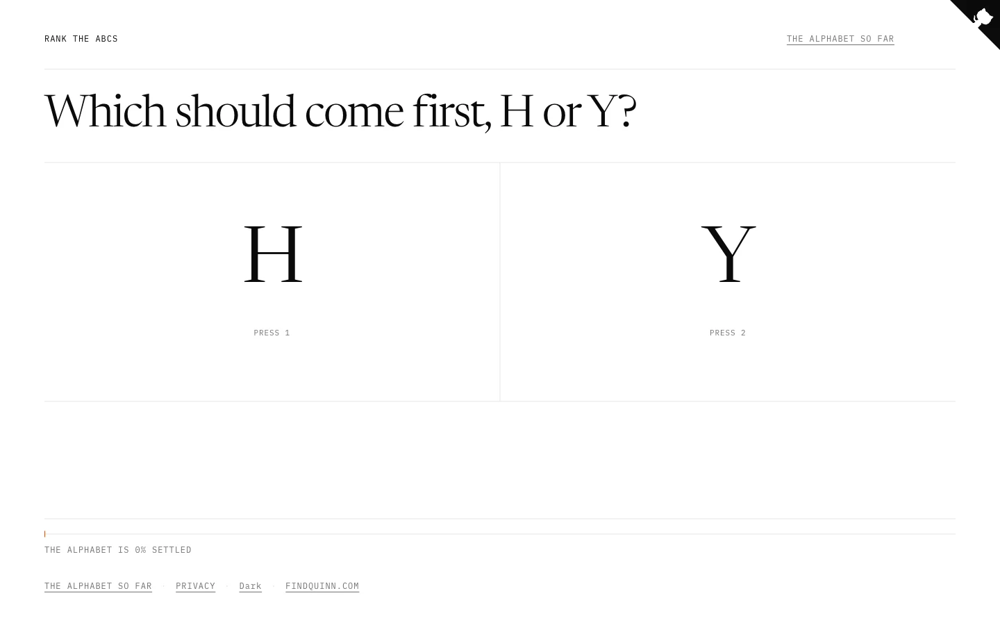

# Rank the ABCs

Nobody chose the order of the alphabet — it arrived through Phoenician traders
and a few Roman decisions, then stopped changing. This is a second opinion: you
get two letters and one question, which comes first, and everyone's answers are
fitted into a new ordering.

**→ [abc.findquinn.com](https://abc.findquinn.com)**

[](https://github.com/nooikko/rank-the-abcs/actions/workflows/ci.yml)
[](LICENSE)



## Features

- **One question at a time** — two letters, which comes first. Nobody is asked
  to rank all twenty-six at once, because nobody has an opinion about all
  twenty-six at once.
- **Votes are relative, never positional.** "Q before E" means *wherever Q ends
  up, E is after it*, at any distance. The current alphabet is not a baseline
  being edited.
- **Three phrasings per pair**, recorded — `WHICH_FIRST`, `SHOULD_BEFORE` and
  `SHOULD_AFTER`, each shown with either letter named first. Logically
  identical prompts get measurably different answers.
- **Bias is estimated, not assumed.** Position bias, acquiescence bias and
  negation drag are fitted alongside the letter scores in one penalised
  logistic regression, and the measured values are published on the rankings
  page.
- **Contradictions are kept.** A crowd will assert E before D, D before Q, and
  Q before E. Rather than picking a winner, those three scores collapse onto
  each other.
- **Uncertainty is shown.** Every letter carries a confidence band; letters the
  comparison graph hasn't connected yet are reported as unplaced rather than
  given a made-up position.
- **Keyboard driven** — `1` and `2` to answer, space to advance.
- **One cookie, set on your first vote**, doing one job: not asking you the
  same question twice. No accounts, no third-party scripts. See
  [Privacy](https://abc.findquinn.com/privacy).

## Getting started

Requires **Node.js 20.9+**, **pnpm**, and a **Postgres** database.

```bash
git clone https://github.com/nooikko/rank-the-abcs.git
cd rank-the-abcs
pnpm install
cp .env.example .env          # fill in DATABASE_URL and QUESTION_TOKEN_SECRET
pnpm exec prisma migrate dev
pnpm dev
```

Then open http://localhost:3001.

> [!WARNING]
> The test suite talks to a real database and **truncates the `Vote` and
> `Session` tables**. Point `DATABASE_URL` at a throwaway database before
> running it.

<details>
<summary>All available scripts</summary>

| Command | What it does |
|---|---|
| `pnpm dev` | Development server on port 3001 |
| `pnpm build` | Generate the Prisma client, then build |
| `pnpm start` | Serve the production build |
| `pnpm test` | Vitest |
| `pnpm lint` | `biome check` |
| `pnpm lint:fix` | `biome check --write` — also fixes import order, which `format` does not |
| `pnpm format` | `biome format --write` |
| `pnpm typecheck` | `tsc --noEmit` |

</details>

## How it works

Next.js 16 (App Router), React 19, TypeScript, Tailwind 4, Prisma 7, Postgres.

Votes are the only source of truth; every count is aggregated on read, so there
is no second copy to drift. The ordering is a Bayesian Bradley-Terry fit over
the whole vote table, recomputed on demand — roughly thirty parameters over at
most 325 pairs, which takes milliseconds.

Two decisions carry most of the design:

**Question selection never consults the ranking model.** It is coverage-driven
and structurally cannot see letter scores. A selector that hunted for questions
likely to upend the alphabet would be a churn machine, and the alphabet would
never settle.

**Voting goes through a Server Action, not a public endpoint**, and every
question carries an HMAC token binding the pair, the phrasing, the presentation
order and the session. You cannot vote on a question the server did not ask
you, which is what stops the ballot being enumerated.

```
src/app/              routes, layout, Server Actions, globals.css (design tokens)
src/lib/alphabet.ts   letters, pairs, templates — the shared vocabulary
src/lib/ranking.ts    the fit: scores, error bars, bias terms
src/lib/votes.ts      the only module that reads or writes votes
prisma/schema.prisma  Session and Vote
.claude/rules/        conventions
docs/superpowers/     the design spec and implementation plan
```

## Things that look wrong and aren't

- **`pnpm outdated` reports newer versions than are installed.**
  `pnpm-workspace.yaml` sets a 7-day cooldown on newly published versions as
  supply-chain hardening. Don't lower it to pick up a release.
- **The Prisma client is gitignored.** Prisma 7 generates it to
  `src/generated/prisma`; `postinstall` and `build` rebuild it.
- **`prisma/schema.prisma` has no `url`.** Prisma 7 moved it to
  `prisma.config.ts` for migrations and to the driver adapter at runtime.
- **There is no `tailwind.config.js`.** Tailwind 4 is CSS-first; the theme is
  in `src/app/globals.css`.
- **There is no ESLint or Prettier.** Biome does both.
- **`opengraph-image.alt.txt` has no trailing newline, deliberately.** With one,
  Next 16 silently drops `og:image:alt` from the output — no warning, no error,
  the tag simply never renders. Don't let an editor "fix" the file.
- **Orange is never a background fill** — hairlines, borders, markers and focus
  rings only.
- **`robots.ts` blocks nothing.** An AI-crawler block would go there; not
  adding one was a decision, not an omission.

## Contributing

[CONTRIBUTING.md](CONTRIBUTING.md) lists the things that will be turned down
and why — worth reading before writing code.

Security issues go through a
[security advisory](https://github.com/nooikko/rank-the-abcs/security/advisories/new),
never a public issue. See [SECURITY.md](SECURITY.md).

## Licence

[MIT with an attribution requirement](LICENSE). Clone it, fork it, change it —
but a deployment other people can reach needs a visible credit linking back to
this repository or to [findquinn.com](https://findquinn.com).

## Credits

Built by [Quinn](https://findquinn.com). The premise belongs to a friend who
said "Q is in a really weird place in the alphabet" and then had to watch this
happen.
